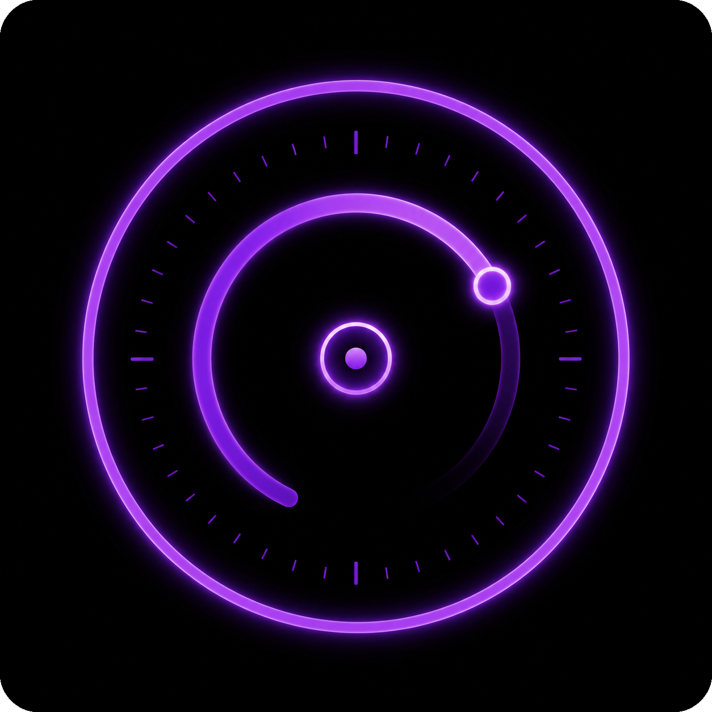

<p align="center">
  
</p>

<h1 align="center">zenritme</h1>

<p align="center">
  <strong>A calm, premium terminal timer, stopwatch, and Pomodoro ritual with built-in procedural sounds.</strong>
</p>

<p align="center">
  <a href="https://ko-fi.com/rezky">
    
  </a>
</p>

> [!WARNING]
> **ARCHIVED — This project is no longer actively developed.**
>
> This repository is preserved as a **read-only artifact**. All code, documentation, and release history remain available for cloning and study, but there will be **no further development, no issue triage, and no security updates**.
>
> **Important:** Unlike projects archived for never reaching their goal, zenritme was archived **complete and stable**. All shipped features work. Development ended as part of a deliberate portfolio triage — not because of defects, security issues, or unfinished work.

---

## Why This Project Was Archived

Documented honestly, for anyone (including future me) wondering what happened:

1. **The product is complete.**
   Timer (up/down), stopwatch, full Pomodoro ritual, 11 themes, 4 views, and a zero-dependency embedded procedural sound system — this is the entire product as designed. Nothing essential was left unfinished. The only features left to build would have been feature creep, not progress.

2. **The terminal timer market is saturated.**
   Solid free alternatives already exist (pot, porsmo, termdown, tmux Pomodoro plugins, or simply `sleep` + `notify-send`). zenritme's differentiators — embedded procedural audio, theming, polished TUI views — are real, but they are aesthetic, and aesthetic differentiation only matters with distribution and marketing behind it.

3. **Distribution never happened.**
   No AUR package, no crates.io publication, no package manager presence — only manual tarball installs. The tool never reached an audience, and building that audience requires sustained effort that was deliberately not allocated.

4. **It was not a daily driver — even for its author.**
   Usage data was unambiguous. A timer that its own author does not reach for daily is unlikely to become a daily tool for anyone else.

5. **Portfolio triage.**
   Time and energy are finite and better allocated elsewhere. This archive is a deliberate, disciplined decision — zenritme is archived as a **completed work, with dignity**, not as a failure.

---

## Status

**ARCHIVED at its final release.**

Everything shipped remains fully functional and safe:

- Timer up/down, stopwatch, and full Pomodoro flow
- 11 themes × 4 views
- Four embedded procedural sounds with per-event overrides, profiles, and cooldowns
- `--check-update` (read-only, queries GitHub releases API)
- Shell completions (bash/zsh/fish) and manpage

If this code is useful to you — fork it. GPL-3.0-only, forks are welcome (forks must rename and rebrand — see [TRADEMARK.md](TRADEMARK.md)).

---

## Conditions for Possible Revival

This project may be unarchived only if, at minimum:

- [ ] Daily personal usage is real — measurably, in shell history
- [ ] A distribution channel (AUR and/or crates.io) is established and maintained
- [ ] Effort for visual positioning (screenshots/GIFs, distinct identity vs existing tools) is genuinely allocated

Until all three are true, this stays an artifact.

---

## Examples

```sh
zenritme --timer-down 25m --theme ember
zenritme --pomodoro --view cinematic --theme aura
zenritme --stopwatch --view minimal --theme mono
zenritme --timer-up --theme void --view orbit
```

## Usage

```
zenritme --timer-up
zenritme --timer-down <DURATION>
zenritme --stopwatch
zenritme --pomodoro [FOCUS BREAK]
zenritme --sound-test
zenritme --check-update
zenritme --check-updated
zenritme --list-themes
zenritme --list-views
zenritme --help
zenritme -V, --version
```

Duration format: `30s`, `10m`, `1h`

### Themes

| Theme | Style |
|-------|-------|
| `void` | Minimal dark |
| `ember` | Warm red/orange |
| `aura` | Purple/magenta |
| `forest` | Green tones |
| `tron` | Classic Tron blue/purple |
| `tron-green` | Tron Legacy green circuit |
| `tron-cyan` | Tron Legacy cyan glow |
| `tron-orange` | Tron Legacy orange flare |
| `tron-red` | Tron Legacy red alert |
| `tron-yellow` | Tron Legacy gold accent |
| `mono` | Monochrome/gray |

### Views

| View | Description |
|------|-------------|
| `minimal` | Compact single-line display |
| `orbit` | Circular progress indicator |
| `cinematic` | Full-width centered box layout |
| `tron` | Tron Legacy perspective grid |

### Check for updates

`zenritme --check-update` queries the GitHub releases API and reports whether
a newer version is available. `--check-updated` is accepted as an alias. This
command is **read-only** — it does not download, install, or replace any
binaries.

```sh
$ zenritme --check-update
zenritme update check
Current: <installed-version>
Latest:  <latest-released-version>
Status:  up to date | update available
Source:  https://github.com/oxyzenQ/zenritme/releases/latest
```

Requires `curl` on the system PATH. Does not require a GitHub token.

### Pomodoro Masterclass

```sh
zenritme --pomodoro                                    # defaults: 25m focus, 5m break, 15m long break, 4 cycles
zenritme --pomodoro 3s 2s                              # legacy positional syntax
zenritme --pomodoro --cycles 4                         # custom cycle count
zenritme --pomodoro --focus 45m --break 10m --long-break 20m --cycles 3
zenritme --pomodoro --focus 3s --break 2s --long-break 4s --cycles 2 --theme aura --view cinematic
```

| Option | Default | Description |
|--------|---------|-------------|
| `--focus` | `25m` | Focus session length |
| `--break` | `5m` | Short break length |
| `--long-break` | `15m` | Long break (after final focus cycle) |
| `--cycles` | `4` | Focus sessions per round |

Session flow: FOCUS 1/N → SHORT BREAK 1/N → … → FOCUS N/N → LONG BREAK → COMPLETE

### Controls

| Key | Action |
|-----|--------|
| `q` / `Esc` | Quit |
| `p` | Pause / resume |
| `r` | Reset current session |

### Sound system

Zenritme ships four built-in procedural notification sounds, embedded
directly into the binary at compile time. No external audio files or network
access are required. The sound system is split into focused submodules
(assets, playback, resolve, cooldown, cleanup) for long-term maintainability.
A no-spam cooldown system prevents rapid sound toggling from producing
audible spam. Temp sound files are automatically cleaned up on process
exit via an RAII guard.

| Event | File | Duration | Description |
|-------|------|----------|-------------|
| Start | `start.wav` | ~250 ms | Gentle two-tone ascending chime |
| Pause | `pause.wav` | ~120 ms | Short soft blip |
| Phase | `phase.wav` | ~500 ms | Two-tone descending chime |
| Complete | `complete.wav` | ~900 ms | Three-note ascending melody |

All sounds are generated by `scripts/generate-sounds.py` using only the Python
standard library — pure sine-wave math, no samples, no copyrighted content.

**Playback chain:** The binary tries `pw-play` (PipeWire/PulseAudio) first.
If unavailable or playback fails, it falls back to the terminal bell (`\x07`).
If `ZENRITME_VISUAL_BELL=1` is set, a screen flash is also triggered.

**No-spam cooldowns** prevent sound spam on rapid toggling:

| Event | Cooldown | Reason |
|-------|----------|--------|
| Start | None | One-shot, fires once per session |
| Pause | 500 ms | Debounce on rapid pause toggle |
| Phase | 1 s | Debounce on phase switch |
| Complete | 2 s | Prevents repeated completion sounds |

**Sound profiles** control when notification sounds play:

| Profile | Behavior |
|---------|----------|
| `calm` (default) | All notification sounds enabled |
| `silent` | All notification sounds suppressed |

The `--mute` flag overrides any profile to silent.

**Per-event overrides** via environment variables:

```
ZENRITME_SOUND_START     /path/to/custom.wav
ZENRITME_SOUND_PAUSE     /path/to/custom.wav
ZENRITME_SOUND_PHASE     /path/to/custom.wav
ZENRITME_SOUND_COMPLETE  /path/to/custom.wav
ZENRITME_SOUND_FILE      /path/to/global-fallback.wav
```

Resolution order: event-specific env → global env → built-in.

**`--mute` flag** suppresses all notification sounds for the session.
**`--sound-profile` flag** selects a sound profile (`calm` or `silent`).

```sh
zenritme --pomodoro --mute             # run silently
zenritme --pomodoro --sound-profile silent  # same as --mute
zenritme --pomodoro --sound-profile calm    # explicit calm (default)
zenritme --sound-test                 # preview all sounds
```

Temp sound files are automatically cleaned up on process exit via an RAII
guard. The cleanup is PID-specific and project-specific, ensuring only
Zenritme's own temp files are removed. Cleanup is idempotent and safe across
panics, Ctrl+C, and normal exit paths.

**Sound module architecture:**

| Module | Responsibility |
|--------|---------------|
| `assets` | Embedded WAV data via `include_bytes!`, env var names, asset metadata |
| `playback` | `pw-play` invocation, terminal bell, visual bell |
| `resolve` | Env override resolution, source display |
| `cooldown` | No-spam cooldown rules and debounce logic |
| `cleanup` | Temp file lifecycle, RAII `TempCleanupGuard` |

### Options

```
--theme <THEME>          void | ember | aura | forest | tron | tron-green | tron-cyan | tron-orange | tron-red | tron-yellow | mono  (default: void)
--view <VIEW>            minimal | orbit | cinematic | tron       (default: orbit)
--sound-profile <P>    calm | silent                          (default: calm)
--mute                   suppress all notification sounds       (default: off)
--focus <DURATION>       focus session length                   (default: 25m)
--break <DURATION>       short break length                    (default: 5m)
--long-break <DURATION>  long break length                     (default: 15m)
--cycles <N>             focus sessions per round               (default: 4)
```

## Install

Build and install instructions are preserved for anyone cloning this archive. Nothing here is maintained.

### From release tarball

```sh
tar xzf zenritme-<release-tag>-linux-amd64-gnu.tar.gz
cd zenritme-<release-tag>-linux-amd64-gnu
./scripts/install.sh --system    # installs to /usr/bin/zenritme (sudo for install step)
# or: ./scripts/install.sh --user  # installs to ~/.local/bin/zenritme (no sudo)
```

The install script builds with `cargo build --release --locked` and installs
the binary. `--system` uses `sudo` only for the install step; `--user` requires
no sudo at all.

### From source

```sh
git clone https://github.com/oxyzenQ/zenritme
cd zenritme
cargo build --release --locked
./scripts/install.sh --system   # or --user
```

### Uninstall

```sh
./scripts/uninstall.sh           # auto-detects /usr/bin, ~/.local/bin
```

### Install locations

| Path | Description |
|------|-------------|
| `/usr/bin/zenritme` | Release binary (`--system`) |
| `~/.local/bin/zenritme` | Release binary (`--user`, default) |

### Release Verification

Each release ships **three** checksums: classical SHA-512 + quantum-resistant
BLAKE2b-512 + SHAKE256. Full instructions in
[docs/VERIFY_RELEASE.md](docs/VERIFY_RELEASE.md).

```bash
# Classical (universal)
sha512sum -c zenritme-<release-tag>-linux-amd64-gnu.tar.gz.sha512sum

# Quantum-resistant — BLAKE2b (fastest, in coreutils)
b2sum -c zenritme-<release-tag>-linux-amd64-gnu.tar.gz.b2sum

# Quantum-resistant — SHAKE256 (NIST PQ standard, via Python)
# openssl's -shake256 default output length varies; Python is consistent
COMPUTED=$(python3 -c "import hashlib; print(hashlib.shake_256(open('zenritme-<release-tag>-linux-amd64-gnu.tar.gz','rb').read()).hexdigest(64))")
EXPECTED=$(awk '{print $1}' zenritme-<release-tag>-linux-amd64-gnu.tar.gz.shake256)
[ "$COMPUTED" = "$EXPECTED" ] && echo "OK" || echo "FAILED"
```

### Shell completions and manpage

Static shell completion files for bash, zsh, and fish are included in the
`completions/` directory. A manpage is provided at `man/zenritme.1`. These
are reference assets; copy them to the appropriate system paths manually if
needed.

## Project docs

- [docs/RULES.md](docs/RULES.md) — project rules, LOC guard, generated assets policy
- [docs/SECURITY.md](docs/SECURITY.md) — security policy and supply-chain minimization *(archived — no active response)*
- [docs/ENDURANCE.md](docs/ENDURANCE.md) — endurance testing and smoke test
- [docs/LONG_USAGE_REPORT.md](docs/LONG_USAGE_REPORT.md) — long-usage validation report
- [docs/RELEASE_CHECKLIST.md](docs/RELEASE_CHECKLIST.md) — pre-release checklist
- [docs/BRANDING.md](docs/BRANDING.md) — brand guidelines and visual identity
- [TRADEMARK.md](TRADEMARK.md) — trademark and intellectual property
- [assets/sounds/README.md](assets/sounds/README.md) — built-in sound documentation
- [scripts/doctor.sh](scripts/doctor.sh) — local binary health check
- [scripts/endurance-smoke.sh](scripts/endurance-smoke.sh) — endurance smoke test

## Principles

- **Zero external dependencies** — the project uses only the Rust standard library.
- **LOC guard** — all core code files must stay under 1000 lines. Enforced by `scripts/check-loc.sh`.
- **Procedural assets** — built-in sounds are generated from code, not downloaded.

## Path security

Zenritme never reads sensitive system files. All user-provided filesystem
paths (currently the `ZENRITME_SOUND_*` environment variables) are validated
through a **whitelist-only** policy: if a path is not inside one of the
explicit allowed roots below, it is denied. No denylist to maintain —
deny-by-default is future-proof.

**Allowed roots** (cross-platform, recursive):

| Platform | Allowed roots |
|----------|---------------|
| Linux / macOS | `~/.config/zenritme/`, `.`, `/etc/zenritme/`, system temp dir |
| Windows | `%APPDATA%\zenritme\`, `.`, `%TEMP%\` |

Everything else is rejected: `~/.ssh/`, `~/.aws/`, `/etc/shadow`, `~/Documents/`,
`/usr/share/sounds/`, `/home/user/file.txt` — all denied by default because they
are not in the whitelist.

Symlinks are resolved via `canonicalize()` before the whitelist check, so a
symlink inside an allowed root that points outside is rejected. Paths that fail
validation trigger a stderr warning and fall back to the built-in embedded sound.

## License

Zenritme is licensed under the **GNU General Public License v3.0 only** (`GPL-3.0-only`).

You may use, study, modify, and redistribute Zenritme under the terms of the GPLv3. Modified versions that are distributed must preserve the same license terms and provide the corresponding source code.

## Intellectual Property & Trademark

**zenritme** is the exclusive intellectual property of
**rezky_nightky (oxyzenQ)**. All rights reserved.

- Source code: licensed under **GPL-3.0-only** (see [LICENSE](LICENSE)).
- Name, logo, branding, and visual identity ("the Marks"): governed by
  [TRADEMARK.md](TRADEMARK.md). The Marks are NOT covered by the GPL and
  are solely and exclusively reserved by the owner.
- This project is **NOT for sale**. Source-code theft, rebranding,
  relicensing, or unauthorized redistribution is strictly prohibited and
  will be enforced.
- Forks must rename, rebrand, and preserve all copyright and license
  notices. See [TRADEMARK.md](TRADEMARK.md) for full terms.

For trademark licensing or written permission, contact
**rezky_nightky (oxyzenQ)** -- https://github.com/oxyzenQ.

---

(c) 2026 rezky_nightky (oxyzenQ). All rights reserved.
zenritme and the zenritme logo are trademarks of rezky_nightky (oxyzenQ).
